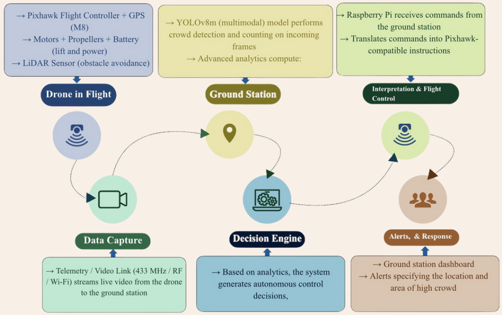
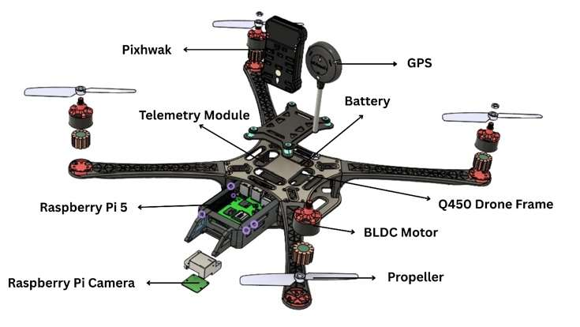
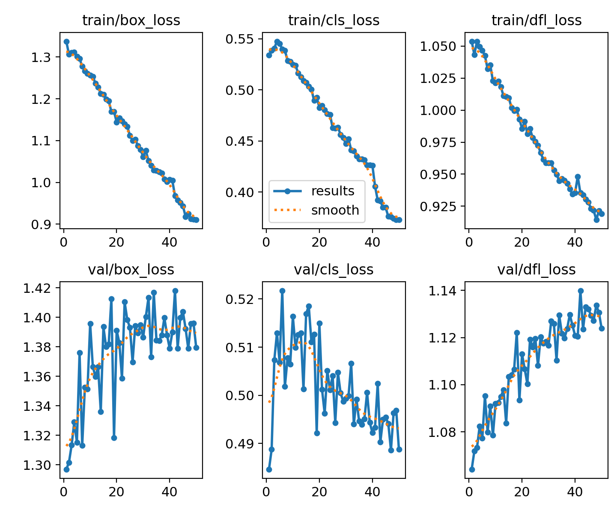
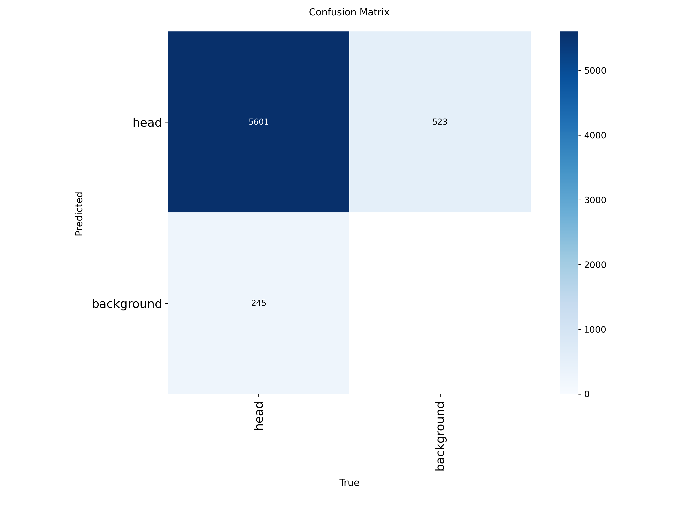
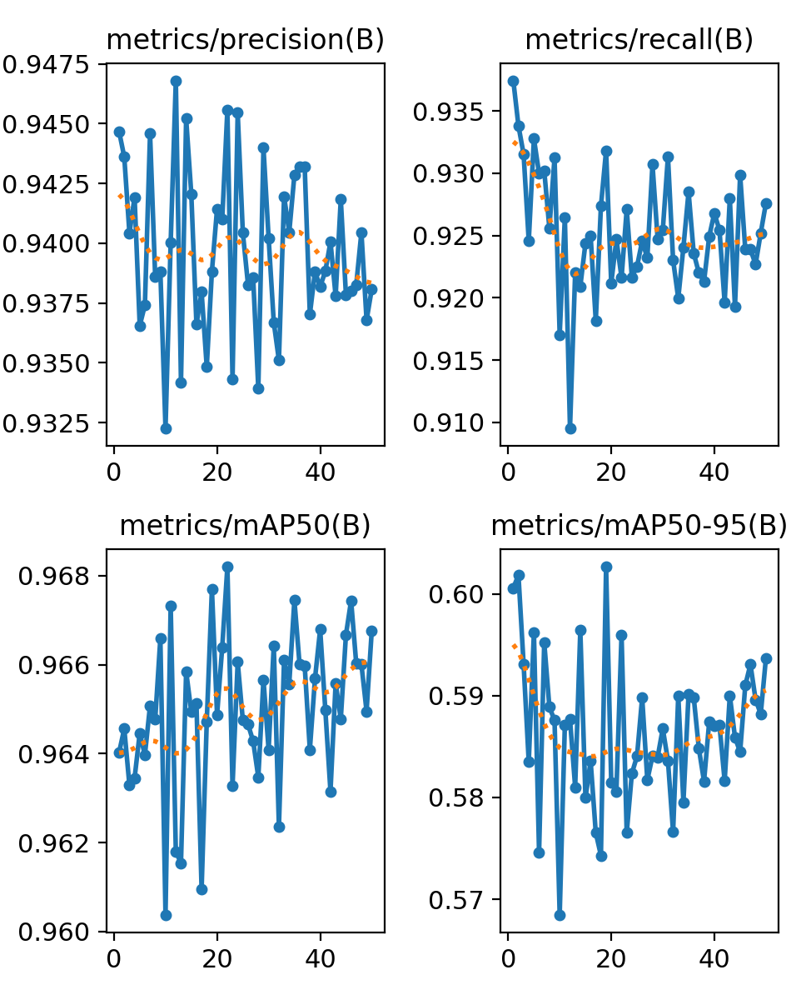
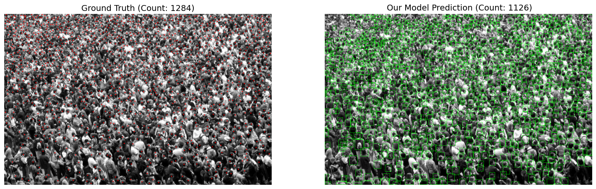
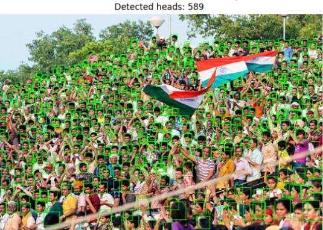

<div align="center">

# SCORVEN
### Smart Crowd Observation and Response Vehicle for Emergency Navigation

**UAV-based crowd head detection and edge-computing feasibility study**

[](https://www.python.org/)
[](https://github.com/ultralytics/ultralytics)
[]()
[]()

*An academic proof-of-concept combining aerial human-head detection with a UAV-mounted edge-computing platform.*

</div>

---

## Overview

SCORVEN explores how unmanned aerial vehicles (UAVs) and computer vision can support crowd monitoring at large public gatherings. Its primary technical component is a **YOLOv8m human-head detector**, fine-tuned on the **SCUT-HEAD** benchmark for detecting and estimating the number of heads in dense crowd imagery.

The project also investigates system-level feasibility by integrating the detection pipeline with a UAV platform built around a **Raspberry Pi 5**, an **Arducam 64 MP camera**, **TF-LUNA LiDAR**, and **ArduPilot-based flight control**. The onboard experiments measure inference latency and resource usage at two input resolutions. Software-In-The-Loop (SITL) simulation was used separately to examine the flight-control and system-integration workflow.

> **Scope clarification:** SCORVEN is a research prototype and proof of concept. The reported onboard frame rates are below real-time video rates. The work does not claim validated real-world autonomous crowd surveillance, operational stampede prediction, or production-ready emergency navigation.

## Key results

| Evaluation | Reported result |
|:--|--:|
| Model | YOLOv8m, fine-tuned |
| Dataset | SCUT-HEAD, Part B |
| Training duration | 50 epochs |
| **mAP@0.5** | **0.968** |
| **mAP@0.5:0.95** | **0.602** |
| Confusion-matrix evaluated samples | 6,369 |
| Confusion-matrix precision | 91.5% |
| Confusion-matrix recall | 95.8% |

The benchmark metrics describe the model's detection performance on the evaluated SCUT-HEAD split. They should not be interpreted as evidence of equivalent performance on every live UAV environment.

## System architecture

SCORVEN brings together four functional areas:

1. **Aerial image capture** — the onboard camera provides the visual input.
2. **Edge-based perception** — YOLOv8m detects human heads in crowd imagery on the Raspberry Pi 5.
3. **Obstacle sensing and flight-control interfaces** — TF-LUNA LiDAR and ArduPilot form part of the UAV integration.
4. **Ground-station communication and monitoring** — MAVLink-based communication supports the system workflow.

The project investigates the integration of perception, onboard computation, sensing, flight control and communication. The architecture is a feasibility prototype, not a validated autonomous emergency-response system.

<div align="center">



*SCORVEN system architecture and processing workflow.*

</div>

## Hardware platform

| Component | Role in the prototype |
|:--|:--|
| Q450 UAV frame | Drone platform |
| Raspberry Pi 5 | Onboard edge-computing processor |
| Arducam 64 MP autofocus camera | Aerial image capture |
| TF-LUNA LiDAR | Obstacle sensing |
| Pixhawk / ArduPilot flight-control setup | Flight-control interface |
| MAVLink telemetry / ground-station link | Communication with the ground station |

The project presentation also describes the platform and its engineering design. The quantitative edge-performance measurements reported in the research manuscript are Raspberry Pi 5 measurements; no separate accelerator-based benchmark is claimed here.

<div align="center">



*UAV platform and onboard component arrangement.*

</div>

## Model development

### Detection task

The model is configured for **human-head detection** in dense crowd scenes. Aerial viewpoints can expose heads even when parts of the body are occluded, but severe overlap, small object size and perspective variation remain challenging.

### Dataset and training

- **Dataset:** SCUT-HEAD, Part B.
- **Task:** Single-class human-head object detection.
- **Input size:** 640 × 640 pixels for the reported training configuration.
- **Initialization:** COCO-pretrained YOLOv8m weights.
- **Training duration:** 50 epochs.
- **Optimizer:** AdamW.
- **Learning-rate schedule:** Cosine annealing.
- **Precision:** Automatic mixed precision (AMP).
- **Annotation format:** YOLO format.
- **Split:** 80:20 training/evaluation split, as described in the research manuscript.

The dataset is a publicly available research benchmark. It is not bundled with this repository. Obtain it from its official source and follow its access and usage terms.

### Training behaviour

The training and validation curves in the research manuscript show the evolution of loss and detection metrics over the 50 training epochs.

<div align="center">



*Training and validation curves over 50 epochs.*

</div>

## Evaluation

### Detection metrics

| Metric | Result |
|:--|--:|
| Precision (confusion-matrix analysis) | 91.5% |
| Recall (confusion-matrix analysis) | 95.8% |
| mAP@0.5 | 0.968 |
| mAP@0.5:0.95 | 0.602 |

The confusion-matrix analysis reports **5,601 true-positive detections, 245 false negatives and 523 false positives** across 6,369 evaluated samples. The reported precision and recall are approximately 91.5% and 95.8%, respectively.

<div align="center">



*Confusion matrix for head-versus-background detection on the SCUT-HEAD evaluation set.*

</div>

### Precision–recall behaviour

The precision–recall curve provides another view of the detector's performance across confidence thresholds. The reported mAP@0.5 is 0.968.

<div align="center">



*Precision–recall curve on the SCUT-HEAD evaluation set.*

</div>

### Qualitative head-count example

A highly crowded example in the research manuscript contains **1,284 annotated heads** and **1,126 detected heads**. This corresponds to an absolute counting error of 158 heads and an undercount of approximately **12.3%** for that particular image.

This is an illustrative dense-scene result, not an aggregate counting-accuracy score. It demonstrates the difficulty of detecting closely overlapping heads under severe occlusion.

<div align="center">



*Ground-truth annotation compared with model detections in a densely crowded scene.*

</div>

### Additional inference example

<div align="center">



*Example head detections produced by the fine-tuned YOLOv8m model.*

</div>

## Raspberry Pi 5 edge-performance evaluation

The model was evaluated onboard at two input resolutions to characterize the trade-off between inference cost and input size.

| Metric | 640 × 640 | 480 × 320 |
|:--|--:|--:|
| Average latency | 2,973.28 ms | 2,073.77 ms |
| Average FPS | 0.34 | 0.48 |
| Peak CPU usage | 41.5% | 38.8% |
| Average CPU usage | 28% | 28% |
| Maximum RAM usage | 1,174 MB | 1,069 MB |
| Peak temperature | 65.3 °C | 65.3 °C |

Reducing the input resolution from 640 × 640 to 480 × 320 lowered measured average latency by approximately **30.3%** and increased average throughput from **0.34 FPS to 0.48 FPS**. Maximum RAM usage decreased by approximately 9%, while measured peak temperature remained 65.3 °C.

**These frame rates are below conventional real-time video-processing rates.** The measurements are reported as an edge-computing feasibility assessment, not as a real-time performance claim.

## UAV integration and simulation

The research manuscript describes a prototype integration involving:

- Raspberry Pi 5 onboard computation.
- ArduPilot flight-control interface.
- TF-LUNA LiDAR obstacle sensing.
- MAVLink-based ground-station communication.
- Software-In-The-Loop (SITL) simulation to assess the flight-control and system-integration workflow.

SITL assessment is distinct from the quantitative model evaluation on SCUT-HEAD. The manuscript does not claim that the system has completed validated real-world autonomous flight and crowd-response trials.

## Repository structure

```text
SCORVEN/
├── README.md
├── requirements.txt
└── Dash Board/
    ├── Dashboard.py
    └── model/
        └── best.pt              # Download separately; not stored in Git
```

The model directory is expected by the existing README instructions. The trained `best.pt` file is not committed to the repository because of its file size. If it is distributed through GitHub Releases, download it and place it at `Dash Board/model/best.pt` before running the dashboard.

## Run the dashboard

### 1. Clone the repository

```bash
git clone https://github.com/Mayank-art-coder/SCORVEN.git
cd SCORVEN
```

### 2. Install dependencies

```bash
python -m pip install -r requirements.txt
```

### 3. Add the trained model

Download `best.pt` from the repository's **Releases** section, if available, and place it here:

```text
Dash Board/
└── model/
    └── best.pt
```

### 4. Launch Streamlit

```bash
cd "Dash Board"
streamlit run Dashboard.py
```

The dashboard should open in your browser. The exact input options and functionality depend on the current implementation in `Dashboard.py`.

## Technology stack

- **Language:** Python
- **Deep learning / detection:** Ultralytics YOLOv8m
- **Computer vision:** OpenCV
- **Dashboard:** Streamlit
- **Data processing:** NumPy, Pandas
- **Visual analytics:** Plotly
- **Edge platform:** Raspberry Pi 5
- **UAV integration:** ArduPilot, MAVLink
- **Obstacle sensing:** TF-LUNA LiDAR
- **Simulation:** Software-In-The-Loop (SITL)

## Limitations

The current study has important limitations:

- Inference on the tested Raspberry Pi 5 configurations remained below real-time video rates.
- Detection and counting become more difficult in heavily occluded and densely overlapping scenes.
- The illustrated dense-scene example undercounted by approximately 12.3%.
- The evaluation does not provide a dedicated cross-dataset or comprehensive real-world UAV robustness study.
- Temporal tracking, sustained crowd-behaviour analysis and validated stampede prediction are not established results of this work.
- Real-world UAV validation and operational public-safety integration remain future work.

## Future research directions

Potential extensions identified in the research include:

- Temporal tracking using methods such as SORT or DeepSORT.
- Improved feature extraction and post-processing for small, overlapping heads.
- Evaluation on more diverse datasets and real-world UAV imagery.
- Further optimization of edge inference.
- Multimodal sensing and broader UAV-system evaluation.
- Future exploration of multi-UAV coordination and public-safety integration.

These are proposed directions, not features claimed as completed in the current prototype.

## Team and acknowledgements

**Project team**

- Taran Santosh Shetty
- Rishikesh Rajendraprasad Saroj
- Mayank Arvind Upadhyay
- Tanmay Ramesh Walunj

**Mentor:** Dr. Shiwani Gupta  
**Department:** Artificial Intelligence and Machine Learning  
**Institution:** Thakur College of Engineering and Technology (TCET), Mumbai, India

The team acknowledges TCET for providing the infrastructure and support required for the project.

## Research manuscript

The project is documented in the manuscript:

*“SCORVEN: A UAV-Based Edge Computing Framework for Crowd Head Detection and Emergency Navigation.”*

The manuscript describes the model training, SCUT-HEAD evaluation, Raspberry Pi 5 performance measurements and proof-of-concept UAV integration. Use the final, approved publication details when citing or linking the paper; do not treat placeholder journal or DOI metadata in a draft as a published citation.

## References

1. L. Wen, D. Du, P. Zhu, Q. Hu, Q. Wang, L. Bo, and S. Lyu, “Detection, Tracking, and Counting Meets Drones in Crowds: A Benchmark,” *Proceedings of the IEEE/CVF Conference on Computer Vision and Pattern Recognition (CVPR)*, 2021, pp. 7812–7821.
2. Y. Li, X. Zhang, and D. Chen, “CSRNet: Dilated Convolutional Neural Networks for Understanding the Highly Congested Scenes,” *Proceedings of the IEEE/CVF Conference on Computer Vision and Pattern Recognition (CVPR)*, 2018, pp. 1091–1100.
3. Ultralytics, *YOLOv8 Documentation*. https://docs.ultralytics.com/
4. SCUT-HEAD, public human-head detection benchmark. Refer to the dataset's official distribution page and licence before use.

---

<div align="center">

**SCORVEN — Exploring aerial computer vision for safer, better-informed crowd monitoring.**

</div>
